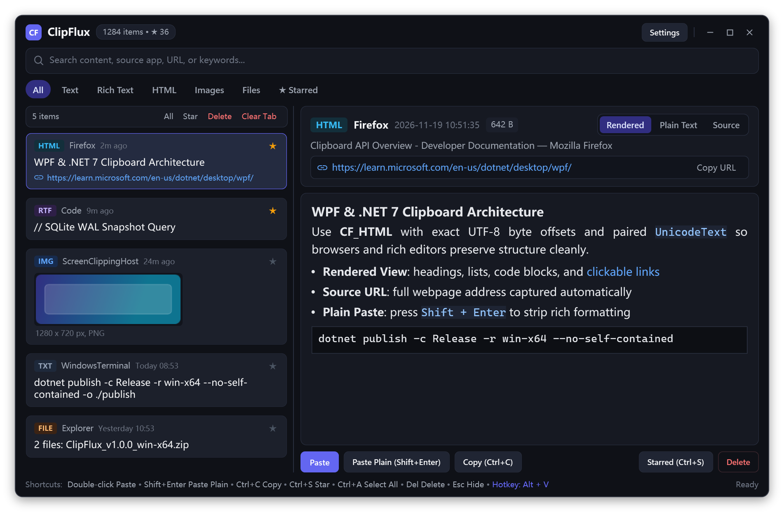
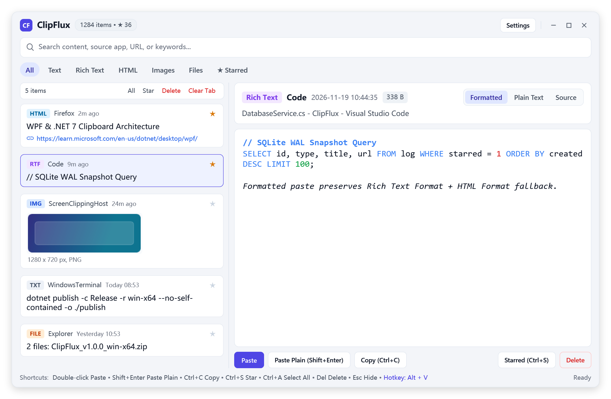
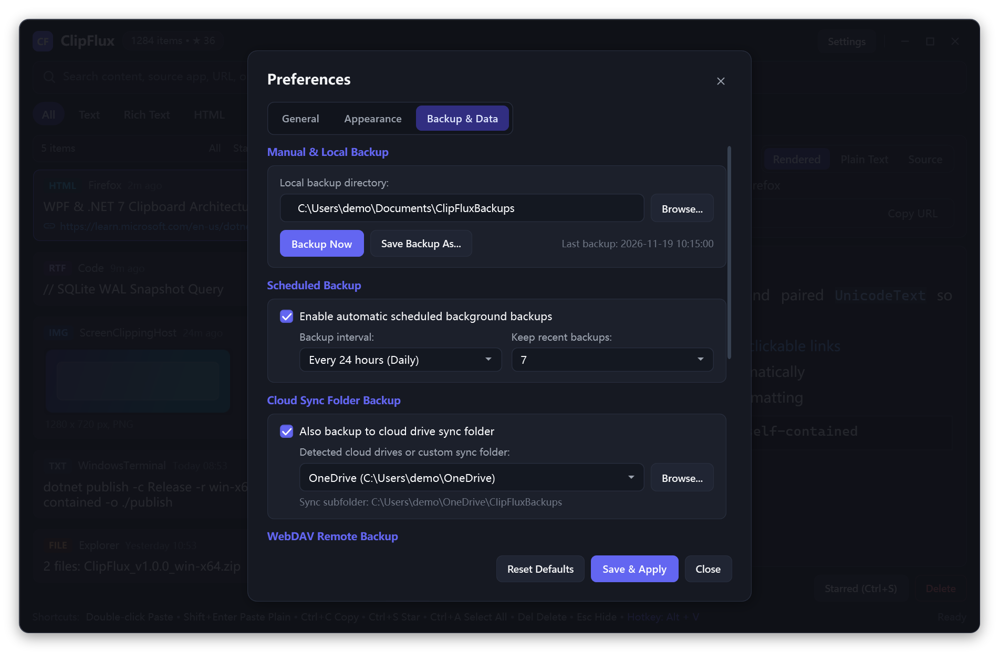

# ClipFlux

[English](README.md) | [简体中文](README.zh-CN.md)

A lightweight Windows clipboard manager written in C# (.NET 7 / WPF) and SQLite.

## Screenshots

**Dark Theme — HTML Preview & Source URL**



**Light Theme — Formatted Rich Text Preview**



**Backup & Sync Settings**



## Features

- **Multi-format capture**: Stores plain text, RTF, HTML fragments, images (PNG/DIB), and file drop lists in a local SQLite database using WAL mode.
- **Rich preview & formatted paste**: Renders HTML and RTF clips with dark/light theme color adaptation and clickable links, with tabs to switch between rendered view, plain text, and raw source. Preserves both `Rich Text Format` and `HTML Format` when pasting RTF, and strips all formatting on plain-text paste (`Shift+Enter`).
- **Source URL tracking**: Extracts page URLs for copied web content (from `CF_HTML` `SourceURL`, `text/x-moz-url-priv`, or the active browser address bar via UI Automation) so links can be opened or copied later.
- **Fast search**: Filters by keyword, source app, URL, or Chinese Pinyin initials (`wx` for `微信`).
- **Backup & import**: Supports WAL-safe manual backups, scheduled background backups with retention pruning, cloud sync folder detection (OneDrive, Google Drive, Dropbox, iCloud Drive, Nutstore, Baidu Syncdisk, or custom folders), WebDAV upload (passwords encrypted via Windows DPAPI), and read-only import from compatible SQLite history files.
- **Bilingual UI & adaptive theming**: Supports English and Simplified Chinese (`zh-CN`), plus Light and Dark themes. Both follow Windows system settings by default.
- **Low idle footprint & privacy**: Skips password manager protected formats (`Clipboard Viewer Ignore`) and trims cached payloads and working set memory when minimized to the system tray.

## Data Storage

History and configuration are stored outside the repository under:

- `%APPDATA%\ClipFlux\history.db` (clipboard database)
- `%APPDATA%\ClipFlux\settings.json` (preferences and DPAPI-encrypted WebDAV credentials)

## Building

Requires Windows 10 (1809+) or Windows 11 and the [.NET 7 SDK](https://dotnet.microsoft.com/download/dotnet/7.0) (or newer).

```bash
git clone https://github.com/NEWnaqahdah/ClipFlux.git
cd ClipFlux

dotnet build -c Release
dotnet publish -c Release -r win-x64 --no-self-contained -o ./publish
```

The compiled executable is output to `./publish/ClipFlux.exe`.

## Shortcuts

| Shortcut | Action |
| :--- | :--- |
| Global hotkey (optional, off by default) | Show / hide window |
| `Double-click` | Paste selected item to active window |
| `Shift + Enter` | Paste selected item as plain text |
| `Ctrl + C` | Copy selected item to clipboard |
| `Ctrl + S` | Star / unstar selected item |
| `Ctrl + A` | Select all visible items |
| `Delete` | Delete selected item(s) |
| `Esc` | Close modal overlay or hide to tray |

## License

[MIT License](LICENSE)
